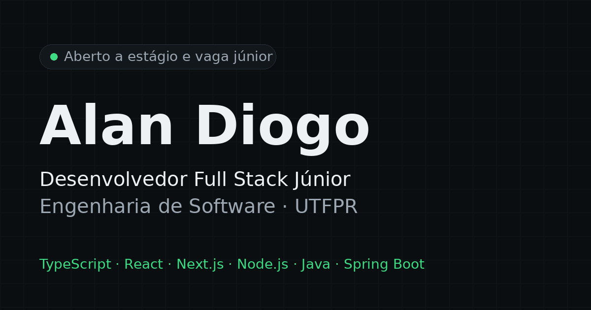

# Portfólio — Alan Diogo

Portfólio de **Alan Diogo**, desenvolvedor full stack júnior e estudante de Engenharia de Software na UTFPR. Feito para recrutadores: projetos com código público, stack, trajetória e currículo em PDF.

**Site:** https://profile-peach-one-26.vercel.app

<p align="center">
  
</p>

## Stack

- **Next.js 14** (Pages Router, páginas estáticas) + **React 18** + **TypeScript 5** (strict)
- **Tailwind CSS 3** com tokens de cor em CSS variables (tema claro/escuro)
- **next/font** (Inter e Space Grotesk, sem bloqueio de render) e **next/image** (WebP, lazy loading, `sizes` responsivo)
- **react-icons**, **ESLint** (`eslint-config-next`), **pnpm**
- Deploy na **Vercel**

## Projetos em destaque

| Projeto | O que é | Links |
|---|---|---|
| Mood Sharing | API REST (Node.js/Express/MongoDB, JWT) + app React Native | [código](https://github.com/AlanDiogoR/Mood-Sharing) |
| Grivy | Controle financeiro: Spring Boot + Nuxt/Vue | [site](https://grivy.netlify.app) · [código](https://github.com/AlanDiogoR/Desafio-Astrocode) |
| Verdan (TCC) | E-commerce full stack com painel em Electron | [código](https://github.com/AlanDiogoR/TCC) |
| CodeLeap Network | Rede social (teste técnico): React, Redux Toolkit, Firebase | [site](https://code-leap-test-tau.vercel.app) · [código](https://github.com/AlanDiogoR/CodeLeap-test) |
| IShop | Loja com checkout Stripe em Next.js | [código](https://github.com/AlanDiogoR/IShop) |

A API do Grivy está temporariamente fora do ar; o front continua publicado.

## Estrutura

```
profile/
├── public/            # imagens (WebP), og.png, favicon, robots.txt, sitemap.xml, cv/
└── src/
    ├── components/    # Header, Hero, Section, ProjectCard, Projects, Skills, Timeline, Contact, Footer, Button, Tag
    ├── contexts/      # ThemeContext (tema claro/escuro salvo no localStorage)
    ├── data/          # conteúdo: bio, projetos, skills, timeline, contato
    ├── pages/         # _app (fontes), _document (lang pt-BR), index (SEO/meta)
    └── styles/        # globals.css (tokens e foco visível)
```

O conteúdo fica em `src/data/`: para adicionar um projeto, basta incluir um item em `projects.ts`.

## Como rodar

Requer Node 18+ e pnpm.

```bash
cd profile
pnpm install
pnpm dev          # http://localhost:3000
pnpm lint         # ESLint
pnpm exec tsc --noEmit
pnpm build && pnpm start
```

`NEXT_PUBLIC_SITE_URL` (opcional) define a URL usada em canonical, Open Graph e JSON-LD.

## Qualidade

- **SEO:** title e description, Open Graph e Twitter Card, canonical, JSON-LD `Person`, `sitemap.xml`, `robots.txt`, `lang="pt-BR"`
- **Acessibilidade:** HTML semântico (`header`, `nav`, `main`, `section`, `article`), link "Pular para o conteúdo", foco visível, `aria-label` em botões de ícone, texto alternativo nas imagens, alvos de toque de 44 px
- **Responsivo:** de 320 px a 1440 px sem rolagem horizontal

## Contato

- E-mail: alandiogor@gmail.com
- GitHub: [AlanDiogoR](https://github.com/AlanDiogoR)
