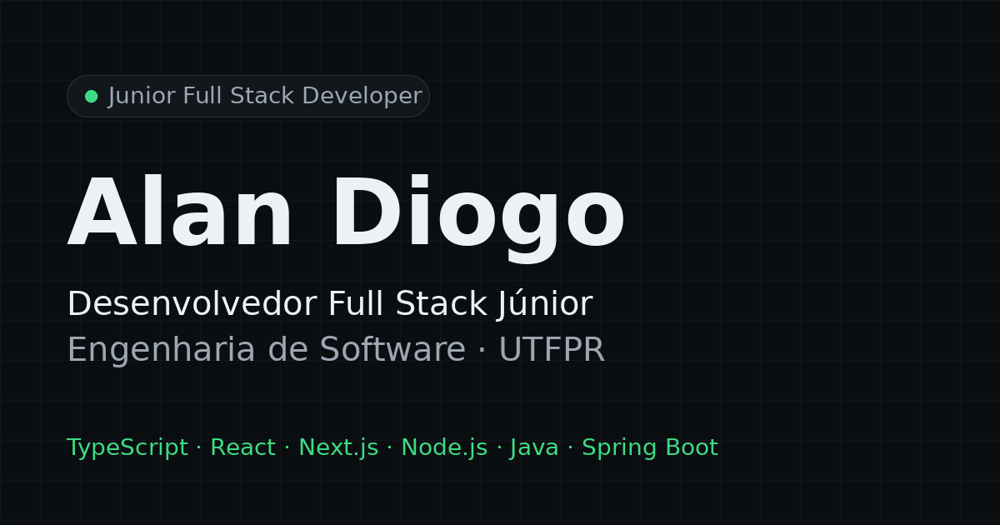

# Portfólio — Alan Diogo

Portfólio de **Alan Diogo**, desenvolvedor full stack júnior no Brasil (UTC-3), aberto a vagas remotas, e estudante de Engenharia de Software na UTFPR. Inglês em `/`, português do Brasil em `/pt`.

**Site:** https://alandiogo.vercel.app

<p align="center">
  
</p>

## Stack

- **Next.js 14** (Pages Router, páginas estáticas) + **React 18** + **TypeScript 5** (strict)
- **Tailwind CSS 3** com tokens de cor em CSS variables (tema claro/escuro)
- **next/font** (Space Grotesk, Inter e JetBrains Mono, sem bloqueio de render) e **next/image** (WebP, lazy loading, `sizes` responsivo)
- **react-icons**, **ESLint** (`eslint-config-next`), **pnpm**
- Deploy na **Vercel**

Dicionários tipados em `src/i18n/`. Não há redirecionamento por `Accept-Language`, cookie ou crawler: a URL pedida é a página servida. O toggle EN | PT grava a escolha em cookie e `localStorage`.

## Projetos em destaque

| Projeto | O que é | Links |
|---|---|---|
| Grivy | Controle financeiro: Spring Boot + Nuxt/Vue | [site](https://grivy.netlify.app) · [vídeo](https://youtu.be/ZRDuhOfDv9A) · [código](https://github.com/AlanDiogoR/Desafio-Astrocode) |
| Mood Sharing | App React Native/Expo + API Node.js/Express/MongoDB | [código](https://github.com/AlanDiogoR/Mood-Sharing) |
| CodeLeap Network | Rede social (teste técnico): React, Redux Toolkit, Firebase | [site](https://code-leap-test-tau.vercel.app) · [código](https://github.com/AlanDiogoR/CodeLeap-test) |
| Verdan (TCC) | E-commerce full stack com painel em Electron | [código](https://github.com/AlanDiogoR/TCC) |
| Controle Financeiro | Entradas, saídas e busca (React, Vite, json-server), commit `a05ce48` | [código](https://github.com/AlanDiogoR/Controle-finaceiro/tree/a05ce48631f37accf88168a31a995b1e09de5b34) |
| IShop | Loja com checkout Stripe em Next.js | [código](https://github.com/AlanDiogoR/IShop) |

Exercícios de curso e repositórios menores (Todo List, Coffee Delivery, Pomodoro, UTF-Projetos, Spring User, ICall, Backend Receitas, API Node.js, Node.js, Exercícios PDF e este site) ficam em “Mais no GitHub”.

A API do Grivy está temporariamente fora do ar; o front continua publicado.

## Estrutura

```
profile/
├── public/            # imagens (WebP), og.png, favicon, robots.txt, sitemap.xml, cv/
└── src/
    ├── components/    # Header, Hero, ProjectCard, Projects, About, Skills, Timeline, Contact, Footer
    ├── contexts/      # ThemeContext (tema claro/escuro salvo no localStorage)
    ├── data/          # metadados: projetos, skills, timeline, contato
    ├── i18n/          # dicionários en e pt, sem redirect automático
    ├── pages/         # / (en), /pt (pt-BR), _document (lang por página)
    └── styles/        # globals.css (tokens e foco visível)
```

## Como rodar

Requer Node 18+ e pnpm.

```bash
cd profile
pnpm install
pnpm dev          # http://localhost:3000
pnpm lint         # ESLint
pnpm exec tsc --noEmit
pnpm build && pnpm start
```

`NEXT_PUBLIC_SITE_URL` (opcional) define a URL usada em canonical, Open Graph, hreflang e JSON-LD. O padrão é `https://alandiogo.vercel.app`.

## Qualidade

- **SEO:** title e description por idioma, Open Graph (`summary_large_image`, `og.png` 1200×630) e Twitter Card, canonical, `hreflang` (`en`, `pt-BR`, `x-default`), JSON-LD `WebPage` + `Person`, `sitemap.xml` com `xhtml:link`, `robots.txt`, `<html lang>` por página
- **Acessibilidade:** HTML semântico, link “Pular para o conteúdo” / “Skip to content”, foco visível, `aria-label` em botões de ícone, texto alternativo nas imagens, alvos de toque de 44 px, toggle de idioma com `hreflang` e `lang`
- **Responsivo:** de 320 px a 1440 px sem rolagem horizontal

## Contato

- E-mail: alandiogor@gmail.com
- GitHub: [AlanDiogoR](https://github.com/AlanDiogoR)
